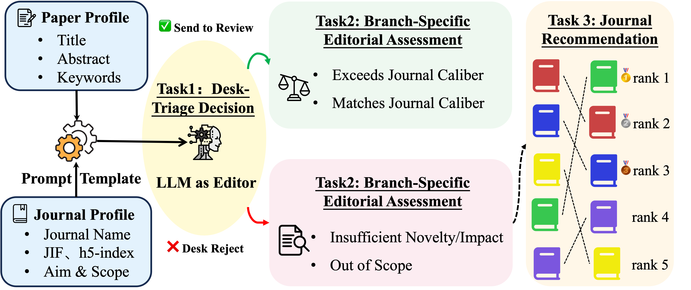
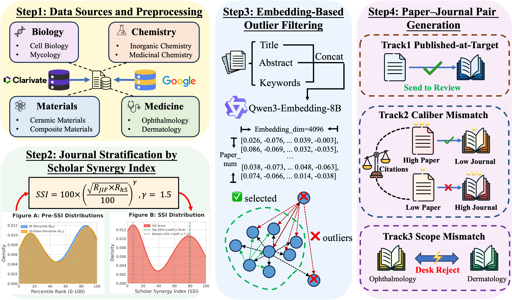

<div align="center">

# PreReviewBench

### Benchmarking LLMs for Editorial Desk Screening in Scholarly Publishing

**Ming Chen\* · Zhiyuan Ning\* · Yi Du**<br>
<sub>\* Equal contribution · Project lead: Zhiyuan Ning · Corresponding author: Yi Du</sub>

<sub>Chinese Academy of Sciences · University of Chinese Academy of Sciences · Westlake University</sub>

[](https://huggingface.co/datasets/kg4sci/PreReviewBench)
[](https://github.com/kg4sci/PreReviewBench)

**7,292 instances · 58 journals · 8 subfields · 4 broad areas · 3 tasks**

[Overview](#overview) · [Dataset](#dataset) · [Main Results](#main-results) · [Quick Start](#quick-start) · [Evaluation](#evaluation) · [Citation](#citation)

</div>

## Overview

Before external peer review, a journal editor must decide whether a manuscript fits the journal and merits reviewer attention. **PreReviewBench** evaluates this editorial desk-screening stage through three connected tasks: desk triage, branch-specific assessment, and transfer-journal recommendation.

The benchmark uses title, abstract, and keyword metadata from papers published in 2025 and indexed in Web of Science, together with target-journal profiles. Because actual desk decisions are confidential, it constructs controlled **proxy labels** through published paper–journal matches, within-subfield caliber mismatches, and cross-subfield scope mismatches.

**The central finding:** models identify clear scope mismatches much more reliably than they judge whether an in-scope paper meets a journal's caliber bar. Across the eight main model–prompt configurations, triage accuracy averages **96.5% on Scope-Mismatch**, versus **57.2% on Caliber-Deficit**.

<p align="center">
  
</p>

### Three editorial tasks

| Task | Required prediction | Evaluation population |
| --- | --- | --- |
| **1. Desk triage** | `Send for Review` or `Desk Reject`, with confidence from 1 to 10 | All instances |
| **2. Branch-specific assessment** | Send: `Matches Journal Caliber` / `Exceeds Journal Caliber`; reject: `Insufficient Novelty/Impact` / `Out of Scope` | The corresponding **gold** branch |
| **3. Transfer recommendation** | Rank candidate journals as transfer destinations | **Gold reject** instances |

The paper's task protocol places triage before access to transfer candidates. Manuscript inputs comprise title, abstract, and keywords; target profiles comprise journal name, JIF, JCR quartile, h5-index, and aims & scope. Source venues, realized publication venues, SSI, and constructed labels are excluded from model inputs. The realized publication venue is the primary transfer-ranking target.

## Dataset

**[Download and explore on Hugging Face →](https://huggingface.co/datasets/kg4sci/PreReviewBench)**

The main benchmark contains **7,292 paper–journal instances**, representing **5,498 distinct papers**. Each of four scenarios contains 1,823 instances, giving 3,646 send and 3,646 reject cases. These are evaluation instances; the release does not prescribe a train/validation/test partition for model training.

### Scenarios and labels

| Paper scenario | JSON `data_type` | Construction | Triage label | Branch label |
| --- | --- | --- | --- | --- |
| Published-at-Target | `Real_Submission` | Paper paired with its publication venue | Send for Review | Matches Journal Caliber |
| Caliber-Surplus | `High_to_Low` | High-SSI source → low-SSI target, same subfield | Send for Review | Exceeds Journal Caliber |
| Caliber-Deficit | `Low_to_High` | Low-SSI source → high-SSI target, same subfield | Desk Reject | Insufficient Novelty/Impact |
| Scope-Mismatch | `Out_of_Scope` | Paper paired with the other subfield in the same broad area | Desk Reject | Out of Scope |

`Real_Submission` is the serialized name for Published-at-Target; it does **not** indicate access to confidential submission records. The JSON uses `Out of scope` for the scope label; the paper displays it as `Out of Scope`, and the evaluator normalizes capitalization.

### Coverage

| Broad area | Source subfield | Per scenario | Total | Within-subfield candidates | Paired-union candidates |
| --- | --- | ---: | ---: | ---: | ---: |
| Biology | Cell Biology | 468 | 1,872 | 10 | 15 |
| Biology | Mycology | 69 | 276 | 5 | 15 |
| Chemistry | Inorganic Chemistry | 234 | 936 | 7 | 14 |
| Chemistry | Medicinal Chemistry | 237 | 948 | 7 | 14 |
| Materials Science | Ceramics | 189 | 756 | 9 | 16 |
| Materials Science | Composites | 297 | 1,188 | 7 | 16 |
| Medicine | Dermatology | 121 | 484 | 7 | 13 |
| Medicine | Ophthalmology | 208 | 832 | 6 | 13 |
| **Total / range** | **8 subfields** | **1,823** | **7,292** | **5–10** | **13–16** |

Caliber-Deficit transfer candidates come from the source subfield; Scope-Mismatch candidates come from the paired-subfield union. Abstracts contain 203.8 words on average, and papers have 8.8 keywords on average.

### Released benchmark files

| File | Instances | Purpose |
| --- | ---: | --- |
| [`benchmark2025.json`](dataset/benchmark2025.json) | 7,292 | Main benchmark, all four scenarios |
| [`benchmark2025_keyword_noise_mixed.json`](dataset/benchmark2025_keyword_noise_mixed.json) | 1,823 | Keyword-noise stress test on Published-at-Target papers; send labels retained |
| [`benchmark2025_synthetic_degradation.json`](dataset/benchmark2025_synthetic_degradation.json) | 1,823 | Synthetic-degradation stress test; labels changed to Desk Reject / Insufficient Novelty/Impact |

These stress tests derive from existing papers rather than adding independent papers. Keyword noise adds five hot-topic and cross-domain terms. Synthetic degradation weakens innovation while preserving broad topic and target fit.

**Text fields:** keyword-noise inputs already contain modified `paper_content.keywords`, with added terms recorded in `added_keywords`. The synthetic-degradation file retains the original `paper_content.abstract_text` and stores the evaluation abstract separately in `degraded_abstract_text`. Use the latter as the abstract when evaluating the released degraded set.

<details>
<summary><strong>Data schema and instance identifiers</strong></summary>

The main file is a JSON array. Its important fields are:

| Field | Meaning |
| --- | --- |
| `uid`, `doi` | Paper identifiers; a paper can occur in multiple scenarios |
| `Category`, `subject` | Broad area and source WoS subfield |
| `data_type` | One of the four serialized scenario names |
| `paper_content` | `title`, `abstract_text`, `keywords` |
| `simulation_setting` | Target-journal name, aims & scope, JIF, JCR quartile, h5-index, and associated metadata |
| `ground_truth` | Realized publication venue, expected decision, and expected branch label |
| `transfer_recommendation_task.candidates` | Candidate option letters, journal names, and profiles |
| `transfer_recommendation_task.candidate_count` | Number of candidates |
| `transfer_recommendation_task.correct_option` | Option letter of the realized publication venue |

Do not deduplicate benchmark instances by `uid` or DOI alone. The scripts identify instances using the paper identifier, scenario, source subject, and target-journal name. Prediction files include the resulting `sample_id`.

Ground-truth fields are for evaluation, not model input. Candidate lists may be present for send cases, but Task 3 is scored only on gold reject cases. The robustness files omit the transfer-recommendation block.

</details>

### Construction

<p align="center">
  
</p>

1. **Select the venue pool.** Use journals represented in both WoS and Google Scholar Top Publications within eight selected subfields, and publication-time metadata for 2025 papers.
2. **Stratify journals.** Compute the Scholar Synergy Index from within-subfield JIF and h5-index percentile ranks; retain the top and bottom 25% of journals.
3. **Filter topical outliers.** Embed title, keywords, and abstract with `qwen3-embedding-8b`, form normalized journal centroids, and filter topically isolated journals using a median-absolute-deviation criterion.
4. **Construct controlled pairs.** Preserve published-at-target pairs; create within-subfield caliber mismatches using pairwise citation separation; create scope mismatches across the two subfields in each broad area, selecting a target with the closest SSI.
5. **Balance scenarios.** Match scenario counts within each source subfield to obtain the final balanced benchmark.

The paper defines SSI as

$$
\mathrm{SSI}=100\left(\frac{\sqrt{R_{\mathrm{JIF}}R_{h5}}}{100}\right)^{1.5},
$$

where the ranks are within-subfield percentiles. SSI is a **venue-level proxy**, not a direct assessment of manuscript quality. Citation separation is imposed **within each high/low journal pair**, not through a universal threshold across journals or fields.

### Expert validation

Four expert-led teams, one per broad area and led by experts outside the author team, blind-reviewed **200 stratified cases** using the same manuscript metadata and target profiles as the models. Annotators did not see source venues, constructed labels, or model outputs.

| Agreement with constructed labels | Result |
| --- | ---: |
| Desk-triage agreement | **98.00%** (196/200) |
| Branch agreement, conditional on triage agreement | **98.47%** (193/196) |
| Joint agreement | **96.50%** (193/200) |

All 60 audited Caliber-Deficit cases received matching triage judgments. Each case was reviewed by one annotator; these statistics describe agreement with proxy labels, not inter-annotator reliability or noise-free ground truth.

## Main Results

The table reproduces the paper's eight main configurations on all 7,292 instances with full journal context. **Direct** requests a structured answer; **Rationale-first** requests a concise 2–4 sentence editorial justification followed by the same answer schema. Both use temperature 0, one finalized run per configuration, and provider-default internal deliberation behavior.

| Model | Prompt | Triage Acc. | Macro-F1 | Q-F1 | R-F1 | Joint | MRR | NDCG@5 |
| --- | --- | ---: | ---: | ---: | ---: | ---: | ---: | ---: |
| GPT-5.5 | Direct | **0.828** | **0.828** | **0.588** | **0.782** | **0.649** | 0.523 | **0.576** |
| GPT-5.5 | Rationale-first | 0.827 | 0.826 | 0.562 | 0.777 | 0.638 | **0.524** | **0.576** |
| DeepSeek-V4-Pro | Direct | 0.808 | 0.809 | 0.371 | 0.747 | 0.566 | 0.465 | 0.526 |
| DeepSeek-V4-Pro | Rationale-first | 0.807 | 0.807 | 0.354 | 0.744 | 0.560 | 0.473 | 0.532 |
| Claude-4.7-Opus | Direct | 0.772 | 0.775 | 0.495 | 0.744 | 0.594 | 0.447 | 0.492 |
| Claude-4.7-Opus | Rationale-first | 0.779 | 0.781 | 0.452 | 0.731 | 0.578 | 0.460 | 0.504 |
| Qwen3.6-Plus | Direct | 0.790 | 0.788 | 0.330 | 0.675 | 0.532 | 0.422 | 0.470 |
| Qwen3.6-Plus | Rationale-first | 0.789 | 0.789 | 0.327 | 0.697 | 0.535 | 0.437 | 0.486 |

Q-F1 and R-F1 use gold send and reject branches, respectively. Joint requires both correct triage and a correct branch label. Transfer metrics are candidate-projected and use the realized venue as the single gold target. All columns above are higher-is-better.

### Key findings

- **Scope is easier than caliber.** Mean triage accuracy is 0.965 on Scope-Mismatch but 0.572 on Caliber-Deficit across the eight main configurations.
- **Correct triage does not ensure correct assessment.** The strongest joint result is 0.649, despite triage accuracy of 0.828.
- **Transfer remains difficult.** GPT-5.5 Direct obtains exact-venue Hit@1 of 0.369. Crediting metadata-compatible alternatives raises it to 0.636; this changes the relevance definition, not the model, and does not establish expert-validated transfer suitability.
- **Short justifications do not consistently help.** Rationale-first prompting does not systematically outperform Direct prompting.
- **Input and prompt changes matter.** Keyword noise reduces send accuracy in six of eight configurations; the best degraded-case reject accuracy is 0.569. A cue suggesting a 90% sendable batch reduces GPT-5.5 Direct's Caliber-Deficit accuracy from 0.603 to 0.351.

The paper also reports logistic-regression and retrieval baselines, journal-context ablations, transfer-format diagnostics, metadata multi-gold sensitivity, closed-book contamination probes, and confidence/prior analyses. Its 42 finalized LLM runs cover the main benchmark, context ablations, two robustness tests, and the GPT-specific send-prior intervention.

## Quick Start

### 1. Install and obtain the data

Use Python **3.10 or newer**. The main JSON is tracked with Git LFS; install Git LFS before cloning, or obtain the data from [Hugging Face](https://huggingface.co/datasets/kg4sci/PreReviewBench).

```bash
git lfs install
git clone https://github.com/kg4sci/PreReviewBench.git
cd PreReviewBench
git lfs pull

python -m venv .venv
source .venv/bin/activate
pip install -r requirements.txt
```

The examples use `dataset/benchmark2025.json`. If downloading separately, place the main JSON there or pass its location with `--dataset` / `--benchmark`.

### 2. Configure an OpenAI-compatible endpoint

```bash
export LLM_API_KEY="YOUR_API_KEY"
export LLM_BASE_URL="YOUR_OPENAI_COMPATIBLE_BASE_URL"
export LLM_MODEL_NAME="YOUR_MODEL_ID"
```

Use the identifier accepted by your provider; paper display names need not be identical to endpoint model identifiers.

### 3. Run inference

Start with a small sample to check access and output format:

```bash
python inference/inference_single_stage_direct.py \
  --dataset dataset/benchmark2025.json \
  --output outputs/direct_smoke.json \
  --num 5
```

Run the full benchmark with either prompt mode:

```bash
python inference/inference_single_stage_direct.py \
  --dataset dataset/benchmark2025.json \
  --output outputs/direct.json

python inference/inference_single_stage_rationale_first.py \
  --dataset dataset/benchmark2025.json \
  --output outputs/rationale_first.json
```

By default, predictions go to **`<output>.jsonl`**. Thus `--output outputs/direct.json` produces `outputs/direct.json.jsonl` and `outputs/direct.json.status.json`. Set `INFERENCE_WRITE_FINAL_JSON=1` to also write the JSON-array output. Reusing an output path resumes from recorded instances; use a fresh path for each model and prompt configuration.

Additional options include `--uid`, `--sample-id`, `--num-shards`, `--shard-id`, and `--finished-from`. Run either script with `--help` for all arguments.

These commands run the repository's **single-stage implementations**. Candidate options appear in the same request with an instruction to consult them after triage; candidate visibility is not enforced through separate API calls as a staged implementation of the paper's protocol would require.

### 4. Evaluate predictions

```bash
python evaluation/evaluate_predictions.py \
  --results outputs/direct.json.jsonl \
  --benchmark dataset/benchmark2025.json \
  --no-plots
```

Omit `--no-plots` for diagnostic figures. Metrics are written beside the prediction file by default; `--out-csv` and `--fig-dir` select alternative destinations. JSON arrays and JSONL predictions are supported.

The evaluator scores the supplied predictions. For full-benchmark comparisons, check coverage of all **7,292 unique instances**; a five-instance smoke test is not a benchmark result. Use the inference-generated result structure, which includes `sample_id`, metadata, `ground_truth`, `transfer_gt`, and `model_response`.

### 5. Run ablations, frozen stress tests, and Claude experiments

The [experiment launcher](scripts/run_experiment.py) selects the released implementations of the paper's six conditions. Both `direct` and `rationale_first` prompts are available.

| `--condition` | Experiment | Paper configurations |
| --- | --- | ---: |
| `main` | Full journal context | 8 |
| `no_metrics` | Remove JIF, quartile, and h5-index | 8 |
| `name_only` | Journal name only | 8 |
| `keyword_noise` | Evaluate the frozen keyword-noise release | 8 |
| `synthetic_degradation` | Evaluate the frozen degraded-abstract release | 8 |
| `send90hint` | GPT send-prior cue | 2 |

Use `--backend openai` for an OpenAI-compatible service, or `--backend anthropic` for the Claude `/v1/messages` implementation. Both accept the `LLM_*` variables above. For the Anthropic backend, set `LLM_BASE_URL` to the service root; the script appends `/v1/messages`.

```bash
# Inspect the command without making an API request.
python scripts/run_experiment.py \
  --condition synthetic_degradation --prompt direct --backend openai \
  --output outputs/gpt/degradation/direct.json --dry-run

# Run Claude after configuring its endpoint and model.
python scripts/run_experiment.py \
  --condition main --prompt rationale_first --backend anthropic \
  --output outputs/claude/main/rationale_first.json
```

Remove `--dry-run` to execute the first example. The launcher selects the matching dataset automatically; `--dataset` overrides it. Frozen degradation entries correctly substitute `degraded_abstract_text`, and both stress tests omit transfer ranking. Use the corresponding stress-test JSON for evaluation; Task 3 is not applicable to those sets.

See the [complete experiment guide](docs/main_experiments.txt) for commands and output conventions. All 22 entry points are self-contained; Claude entries do not require a separate common module. Prompts, input adapters, and inference/retry behavior are preserved from the experimental implementations; configuration validation, default paths, and status messages are adapted for release.

## Evaluation

| Component | Metrics and interpretation |
| --- | --- |
| Desk triage | Accuracy, Macro-F1, balanced accuracy, false-reject rate on gold send cases, false-send rate on gold reject cases, parsed-decision rate |
| Branch assessment | Q-F1 on gold send cases; R-F1 on gold reject cases; invalid-prediction rate; joint editorial correctness |
| Transfer ranking | Candidate-projected MRR, Hit@k, NDCG@k on gold reject cases; missing gold targets receive zero credit |
| Output compliance | Nonempty-ranking rate, complete-permutation rate, Strict and Valid Only ranking variants |
| Confidence | Diagnostics from the requested 1–10 confidence score, including calibration analyses |

**Candidate-projected** metrics remove out-of-candidate entries while preserving order. **Strict** metrics assign zero to rankings whose projected lists are not complete permutations. **Valid Only** metrics condition on complete permutations and should not be compared directly with all-case scores.

The paper's metadata multi-gold analysis assigns relevance 2 to the realized venue and relevance 1 to alternatives sharing its subfield and SSI stratum, excluding the rejected target. These are weak metadata-based compatibility labels. The primary results above retain exact-venue evaluation.

## Repository Guide

```text
PreReviewBench/
├── assets/                 # Task and construction figures from the paper
├── dataset/                # Main benchmark and robustness data
├── dataset_build/          # Metadata processing, SSI, pairing, and stress tests
├── inference/              # Original direct and rationale-first entry points
│   └── experiments/        # OpenAI-compatible and Anthropic experiment entries
├── evaluation/             # Metrics and diagnostic plots
├── scripts/                # Unified experiment launcher
├── docs/                   # Experiment guide
├── tests/                  # Offline input, output, and resume checks
├── requirements.txt
└── README.md
```

Construction scripts cover metadata merging, year filtering, embeddings, journal-profile enrichment, SSI, in-scope pairing, scope mismatch, and robustness experiments. Configure their input/output placeholders for your source metadata and environment. Full reconstruction additionally requires upstream paper/journal metadata and intermediate resources; the final benchmark is sufficient for the main inference workflow.

The robustness-generation scripts in `dataset_build/` generate perturbations and run experiments. To evaluate the frozen releases, use `scripts/run_experiment.py` with `keyword_noise` or `synthetic_degradation`; its dedicated entries load the published perturbations without regenerating them. The original generic scripts directly under `inference/` do not substitute the degraded abstract automatically.

## Intended Use and Limitations

PreReviewBench supports **editorial decision support and auditing**, not autonomous accept/reject decisions.

- Labels are constructed proxies, not observed confidential desk decisions. Publication venue, SSI, and citation contrast do not directly establish manuscript quality or an editor's threshold.
- Inputs are final indexed publication-time abstracts, not original submission versions. Coverage is restricted to 2025, four broad areas, eight subfields, and 58 journals.
- Expert validation covers 200 cases, with one annotator per case. High agreement does not eliminate scope/caliber boundary ambiguity.
- The paper reports one finalized temperature-0 run per configuration without estimating API-version or run-to-run variance. Closed-book probes cannot rule out training-data overlap.
- Multiple transfer venues may be reasonable. Exact-venue and metadata multi-gold scores use different target definitions; neither establishes editor-validated transfer suitability.
- Confidence scores are diagnostic signals, not calibrated probabilities. Human accountability remains necessary, particularly where screening may amplify disciplinary or prestige-related bias.

## Citation

If you use PreReviewBench, please cite the accompanying manuscript:

```bibtex
@misc{chen_prereviewbench,
  title = {{PreReviewBench}: Benchmarking LLMs for Editorial Desk Screening in Scholarly Publishing},
  author = {Chen, Ming and Ning, Zhiyuan and Du, Yi},
  howpublished = {Accompanying manuscript},
  url = {https://github.com/kg4sci/PreReviewBench}
}
```

## Contact

For questions and reproducibility reports, open a [GitHub issue](https://github.com/kg4sci/PreReviewBench/issues). Research inquiries: [Ming Chen](mailto:chenming@cnic.cn), [Zhiyuan Ning](mailto:ningzhiyuan@westlake.edu.cn), or [Yi Du](mailto:duyi@cnic.cn).
